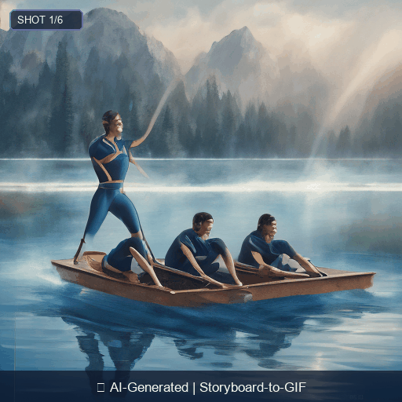
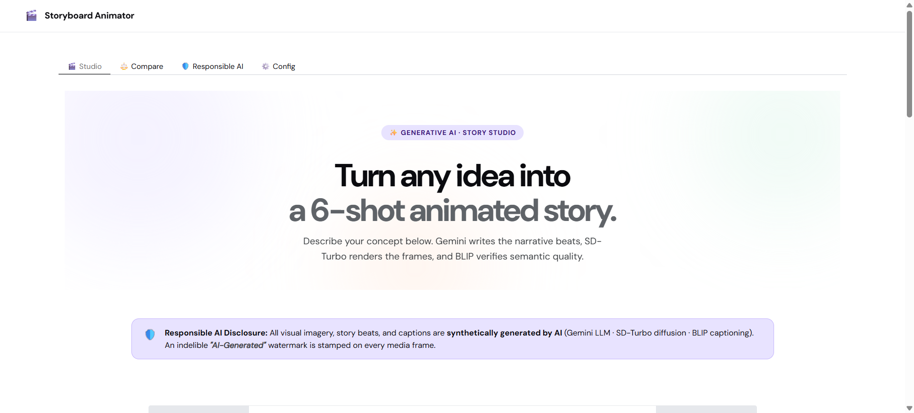
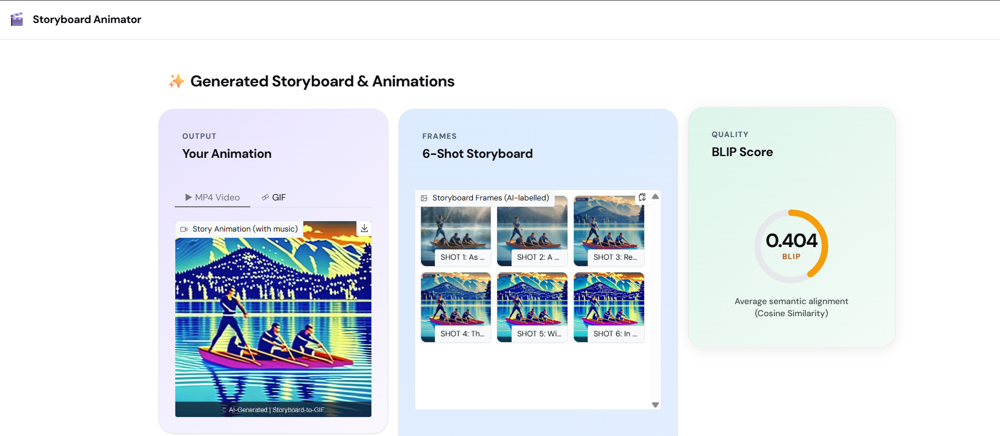
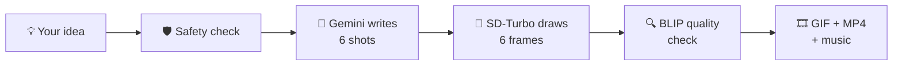

<div align="center">


# MIT ART, DESIGN AND TECHNOLOGY UNIVERSITY
**MIT SCHOOL OF COMPUTING, PUNE**
*Department of Computer Science and Engineering*

---

**GENERATIVE AI · LLM MINI-PROJECT (P44)** · Academic Year 2026–2027

# 🎬 Storyboard-to-GIF Animator
### Turn any text idea into a 6-shot animated clip with music, using Generative AI

[](https://www.python.org/)
[](https://www.gradio.app/)
[](https://ai.google.dev/)
[](https://huggingface.co/)
[](#-licenses)

| | |
|---|---|
| **Submitted by** | Sanjyot Sharad Dhamal |
| **Roll No. / Division** | 44 / 3 |
| **Enrolment No.** | ADT23SOCB0977 |
| **Course** | Generative AI |
| **Course Coordinator** | Dr. Snehalata Funde |

</div>

---

## 📖 What is this project?

Planning an animation usually starts with a **storyboard**: a row of pictures that tells the story shot by shot. Making one by hand takes time and drawing skill.

This app does it for you. You type a short idea, for example:

> *"A rowing team trains at sunrise on a calm lake"*

and the app gives you:

- 📝 a **6-shot story** written by an AI (Google Gemini)
- 🎨 **6 pictures**, one for each shot, drawn by an image AI (Stable Diffusion Turbo)
- 🔍 a **quality score** for every picture, so you can see which ones do not match the story
- 🎞️ an **animated GIF and MP4 video** with smooth fades and background music
- 🏷️ an **"AI-Generated" label** on every frame, so nobody is misled

---

## 🎥 Demo

**Sample output** (idea: *A rowing team trains at sunrise on a calm lake*):

<div align="center">



</div>

**Screenshots of the app:**

<table>
  <tr>
    <td align="center"><br/><sub>Home screen: idea box, presets and Generate button</sub></td>
    <td align="center"><br/><sub>Result: 6 frames, video and quality table</sub></td>
  </tr>
</table>

🔗 **Live app:** (https://e3d549c7272843b2fb.gradio.live)

---

## ⚙️ How it works



| Step | What happens | File |
|:-:|---|---|
| 1 | You type an idea and press **Generate** | `app.py` |
| 2 | A **safety filter** blocks unsafe ideas (violence, hate, adult content, real people, copyrighted characters) | `safety.py` |
| 3 | **Gemini** splits the idea into 6 shots and returns them as JSON (shot number, camera, picture prompt, caption) | `llm.py` |
| 4 | **SD-Turbo** draws one picture per shot using a fixed *seed*, so the pictures share a similar look | `imagegen.py` |
| 5 | **BLIP** looks at each picture and describes it in words. A text model then checks how close that description is to the planned shot. Low scores are flagged | `blip_check.py` |
| 6 | The frames are cross-faded into a **GIF** and an **MP4** with music and an AI-Generated label | `video.py` |

### 🎓 How it covers the course units

| Unit | Task | Where in the project |
|:-:|---|---|
| **U1** | Write shot-list prompts | Zero-shot and few-shot prompts in `llm.py`, with a side-by-side comparison tab |
| **U2** | Generate the storyboard with the LLM | Gemini returns 6 shots as JSON |
| **U3** | Frames with a fixed seed; BLIP consistency check | SD-Turbo with seed 42; BLIP + similarity score per frame |
| **U4** | Cross-fade into GIF/MP4 with music | `video.py` blends frames and adds an ambient music track |
| **U5** | AI-generated disclosure label | Label on every frame, plus guardrail, model card and licence notes |

---

## ✨ Features

- **Zero-shot vs few-shot prompting**: compare a plain prompt with a prompt that includes two examples
- **Same look in every shot**: one shared style description and a fixed, changeable seed (default `42`)
- **Automatic quality check**: BLIP + `all-MiniLM-L6-v2` give each frame a score; frames below `0.35` are marked **MISMATCH**
- **Smooth animation**: about 10 blended frames between shots, saved as GIF and MP4
- **Music**: a built-in ambient track (generated in Python, public domain) or your own file in `assets/`
- **Responsible AI**: safety filter, visible AI label on every frame, model card
- **Flexible image engine**: runs on your own computer with SD-Turbo, or through the Hugging Face API if your computer is slow

---

## 📊 Results: zero-shot vs few-shot

We tested 5 story ideas with both prompt styles (same seed `42`, 6 frames each). The **BLIP alignment score** goes from 0 to 1, and **higher is better**. A frame below `0.35` counts as a mismatch.

| # | Story idea | Zero-shot | Few-shot | Change | Mismatched frames (zero / few) |
|:-:|---|:-:|:-:|:-:|:-:|
| 1 | A small lonely robot in a greenhouse learns to paint flowers | 0.3920 | 0.4506 | **+14.9%** | 1 / 0 |
| 2 | A timid sea turtle discovers a glowing celestial star in a spiral shell | 0.3275 | 0.3544 | **+8.2%** | 6 / 2 |
| 3 | An old clockmaker invents a mechanical hummingbird that takes flight | 0.2562 | 0.3426 | **+33.7%** | 6 / 4 |
| 4 | A whimsical cat baker accidentally creates a flying croissant balloon | 0.3244 | 0.4054 | **+25.0%** | 5 / 0 |
| 5 | A young botanist cultivates a giant glowing bioluminescent mushroom tree | 0.2940 | 0.3410 | **+16.0%** | 6 / 4 |
| | **Average** | **0.3188** | **0.3788** | **+18.8%** | **24 / 10** |

**What this shows:** giving the AI two examples (few-shot) made the pictures match the story better in all 5 tests, and cut the mismatched frames from 24 to 10 out of 30. The numbers come from one run, so they show a clear trend, not an exact measurement.

The full tables are in [`results/results.md`](results/results.md), and a failure case (a frame where the robot was missing) is explained in [`results/failure_case.md`](results/failure_case.md).

---

## 🛠️ Tech stack

| Part | Tool |
|---|---|
| Web interface | **Gradio** (Python) |
| Story writing (LLM) | **Google Gemini** (Flash model) |
| Picture generation | **Stable Diffusion Turbo** (`stabilityai/sd-turbo`) with Hugging Face **Diffusers** and **PyTorch** |
| Picture description | **BLIP** (`Salesforce/blip-image-captioning-base`) |
| Text similarity | **Sentence-Transformers** (`all-MiniLM-L6-v2`) |
| Video and audio | **Pillow**, **imageio**, **moviepy**, Python `wave` |

---

## 🚀 Run it on your computer

**You need:** Python 3.10 or newer. A GPU is optional (without one, picture generation is slower).

### 1. Get the code and install

```bash
git clone https://github.com/sanjyotdhamal/storyboard-to-gif-animator.git
cd storyboard-to-gif-animator

python -m venv venv

# Windows (PowerShell)
.\venv\Scripts\Activate.ps1
# Mac / Linux
source venv/bin/activate

pip install -r requirements.txt
```

### 2. Add your keys

Copy the example file, then open `.env` and paste your keys:

```bash
cp .env.example .env        # on Windows: copy .env.example .env
```

```env
# Free key from https://aistudio.google.com/app/apikey
GEMINI_API_KEY=your_gemini_api_key_here

# Free token from https://huggingface.co/settings/tokens (used for the API image mode)
HF_TOKEN=your_hf_token_here

# 'auto', 'local_diffusers', 'hf_api' or 'mock'
IMAGE_GEN_MODE=auto

# Frames scoring below this are flagged as mismatches
MISMATCH_THRESHOLD=0.35
```

> 🔒 Never share your keys or upload `.env` to GitHub. It is already listed in `.gitignore`.

> ⚠️ **No Gemini key?** The app still opens and runs with a simple built-in storyboard so you can test the screens, but that story is **not** written by the AI and will not follow your idea closely. Add a real key for proper results.

### 3. Start the app

```bash
python app.py
```

Open **https://e3d549c7272843b2fb.gradio.live** in your browser, type an idea (or click a preset) and press **Generate**.

> ⏱️ On a computer without a GPU, making 6 pictures can take several minutes. For faster results set `IMAGE_GEN_MODE=hf_api` to use Hugging Face's servers.

### Repeat the experiment

```bash
python evaluate_course_test.py
```

This runs the zero-shot vs few-shot test on 5 ideas and saves the results in the `results/` folder.

---

## ☁️ Put it online (Hugging Face Spaces)

1. Go to [huggingface.co/spaces](https://huggingface.co/spaces) and click **Create new Space**.
2. Choose **Gradio** as the SDK.
3. Upload the project files (`app.py`, the module files, `requirements.txt`, `assets/`, and so on).
4. Open **Settings → Variables and secrets** and add two secrets: `GEMINI_API_KEY` and `HF_TOKEN`.
5. On the free CPU tier, also add `IMAGE_GEN_MODE` = `hf_api`.
6. Wait for the build to finish. Your app is now live at a public link.

---

## 📁 Project structure

```text
storyboard-to-gif-animator/
├── app.py                  # Gradio web app (the 4 tabs)
├── safety.py               # Safety filter for unsafe ideas
├── llm.py                  # Gemini prompts (zero-shot / few-shot) and JSON parsing
├── imagegen.py             # SD-Turbo / Hugging Face API image generation + AI label
├── blip_check.py           # BLIP captions + similarity score
├── video.py                # Cross-fade, GIF/MP4 export, music
├── evaluate_course_test.py # Runs the zero-shot vs few-shot experiment
├── requirements.txt        # Python packages
├── .env.example            # Template for your keys (no real secrets)
├── MODEL_CARD.md           # What each model does, its limits and licence
├── assets/                 # Music files
├── docs/
│   ├── assets/logo.png     # University logo (used in this README)
│   ├── screenshots/        # App screenshots (used in this README)
│   ├── lifecycle.md        # Pipeline diagram
│   └── concepts.md         # Plain-language notes (attention, diffusion, prompting)
├── results/                # results.csv, results.md, failure_case.md
└── sample_output/          # One 6-frame sample clip and its prompts
```

---

## 🛡️ Responsible AI

1. **Safety filter:** blocks ideas about violence, hate, adult content, real living public figures and trademarked characters before any AI model is called.
2. **Quality check:** BLIP describes each frame, and a similarity score flags frames that do not match the story (for example, a missing character).
3. **Clear label:** every frame carries a visible **✨ AI-Generated** mark, and the app shows a disclosure banner.
4. **Model card:** [`MODEL_CARD.md`](MODEL_CARD.md) lists each model, how it should be used, its limits and its licence.

---

## ⚠️ Limitations and future ideas

- The 6 pictures look similar but are **not identical**. A character can change slightly from shot to shot.
- The BLIP score is a **helper, not a judge**. A low score does not always mean a bad picture.
- The safety filter uses word rules, so it can miss unusual wording.
- Picture generation is slow without a GPU.

**Ideas for the future:** keep the character more consistent (image-to-image or reference images), regenerate flagged frames automatically, add voice-over narration, and support longer clips.

---

## 📜 Licenses

| Item | Licence |
|---|---|
| Project code | MIT License |
| SD-Turbo weights | Stability AI licence (see the [model page](https://huggingface.co/stabilityai/sd-turbo)) |
| BLIP weights | BSD 3-Clause (Salesforce Research) |
| all-MiniLM-L6-v2 | Apache 2.0 |
| Music (`assets/ambient_story_theme.wav`) | Generated in Python, dedicated to the public domain (CC0 1.0) |
| Generated images and videos | Synthetic AI output, made for educational coursework and non-commercial use |

---

## 🙏 Acknowledgements

Thanks to **Dr. Snehalata Funde** for guiding the Generative AI course, and to the teams behind Google Gemini, Stability AI, Salesforce BLIP, Sentence-Transformers, Hugging Face and Gradio.

<div align="center">

Made with ❤️ by **Sanjyot Dhamal** · MIT-ADT University, Pune

</div>