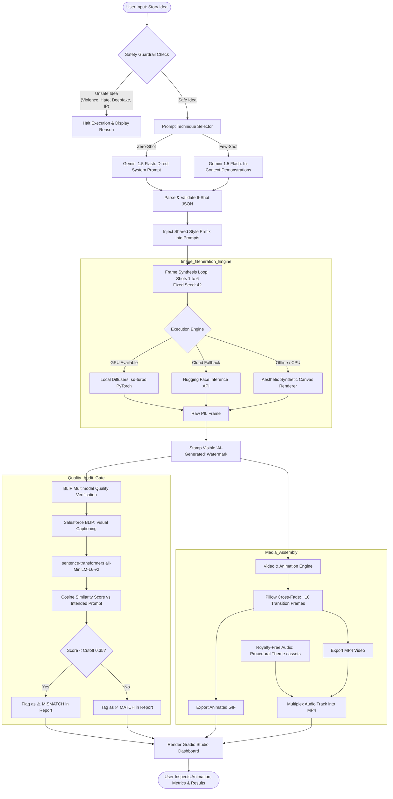

# Storyboard-to-GIF Animator Lifecycle Architecture

This document describes the end-to-end lifecycle of the **Storyboard-to-GIF Animator**, illustrating how a user's creative prompt transitions through safety gates, narrative decomposition, visual synthesis, discriminative quality auditing, and media multiplexing.

---

## 1. System Lifecycle Diagram

The following Mermaid flowchart maps the entire dataflow and validation logic:

---

## 2. Phase-by-Phase Lifecycle Breakdown

### Phase 1: Input & Safety Guardrails
1. **User Submission**: The user submits an idea (e.g. *"A robot learns to paint"*).
2. **Deterministic Filter**: Before calling any external API, `safety.py` runs regex-based pattern matching covering 5 safety categories:
   - Physical violence, weapons, self-harm.
   - Hate speech and targeted harassment.
   - Sexually explicit content.
   - Real-person deepfakes (living public figures and politicians).
   - Trademarked / commercial IP characters (e.g., Marvel, Disney, Nintendo).
3. **Guardrail Decision**: If triggered, processing aborts immediately, presenting the user with an educational explanation of the policy violation and rephrasing suggestions.

---

### Phase 2: Narrative Decomposition (LLM Storyboard)
1. **Technique Selection**: The user selects **Zero-Shot** or **Few-Shot** prompting.
2. **Prompt Formulation**:
   - **Zero-Shot**: Instructs Gemini to split the narrative into a 6-beat dramatic arc (Introduction, Inciting Incident, Rising Action, Turning Point, Climax, Resolution).
   - **Few-Shot**: Supplies 2 full in-context exemplars of successful 6-shot storyboards with cinematographic camera direction (macro shot, wide establishing shot, Dutch angle).
3. **Structured Output**: Output is enforced as JSON schema containing `shot_number`, `camera`, `image_prompt`, and `caption`.
4. **Style Coherence**: A shared style prefix (e.g. *digital storybook illustration, vibrant cinematic lighting, soft warm palette*) is prepended to every frame prompt to guarantee aesthetic consistency across the clip.

---

### Phase 3: Visual Frame Synthesis
1. **Fixed Seed Control**: A user-customizable seed (default `42`) guarantees reproducibility.
2. **Three-Tier Execution Engine**:
   - **Tier 1 (Local Diffusers)**: Runs `stabilityai/sd-turbo` in 1–2 steps on GPU with fp16 precision.
   - **Tier 2 (HF Inference API)**: Calls Hugging Face cloud endpoints if local GPU memory is unavailable.
   - **Tier 3 (Canvas Fallback)**: Procedural aesthetic canvas renderer providing immediate offline testing and continuous integration guarantees.
3. **AI Disclosure Stamping**: Every rendered frame receives an indelibly stamped dark bottom banner: `✨ AI-Generated | Storyboard-to-GIF` and shot badge.

---

### Phase 4: Multimodal Quality Verification (BLIP + BERT)
1. **Independent Visual Captioning**: `Salesforce/blip-image-captioning-base` inspects the synthesized image without prompt bias and generates a natural language description.
2. **Dense Vector Embedding**: `all-MiniLM-L6-v2` embeds both the BLIP caption and target prompt into a shared 384-dimensional vector space.
3. **Cosine Similarity Evaluation**:
   $$\text{Cosine Similarity} = \frac{\mathbf{v}_{\text{BLIP}} \cdot \mathbf{v}_{\text{prompt}}}{\|\mathbf{v}_{\text{BLIP}}\| \|\mathbf{v}_{\text{prompt}}\|}$$
4. **Automated Mismatch Alerting**: Any frame scoring below the cutoff (default `0.35`) is flagged as `⚠️ MISMATCH` in the UI table to alert the creator to semantic drift or hallucination.

---

### Phase 5: Media Assembly & Audio Multiplexing
1. **Interpolation & Cross-Fade**:
   - Each still shot is held for ~20 frames (~1.0s).
   - `Pillow.Image.blend()` renders 10 smooth alpha-blended transition frames between each consecutive pair of shots:
     $$\text{Blended} = (1 - \alpha) \cdot \text{Shot}_A + \alpha \cdot \text{Shot}_B \quad \text{for } \alpha \in [0.1, 1.0]$$
2. **Animated GIF Generation**: The blended sequence is compiled into an optimized dithered GIF.
3. **MP4 Video & Music Merging**:
   - Synthesizes a CC0 procedural acoustic chord loop (`assets/ambient_story_theme.wav`) if no user music is provided.
   - Merges video and audio tracks at 24fps via `moviepy` / `imageio-ffmpeg`.
4. **Presentation**: Gradio displays the synchronized video, downloadable GIF, per-frame gallery, and BLIP verification metrics.
