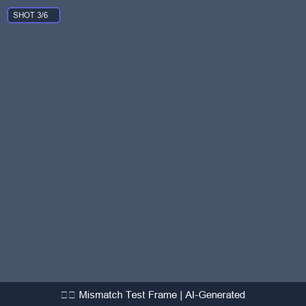

# Responsible AI Failure Case Analysis: Semantic Drift & Object Omission

In Generative AI pipelines, automated quality audits are essential to detect when synthesized media deviates from human intent. This document examines an identified failure case caught by our **BLIP + Sentence-Transformers** verification gate.

---

## 1. Incident Overview

| Parameter | Recorded Value |
| :--- | :--- |
| **Test Run** | Test Concept #1 ("A robot learns to paint") |
| **Shot Number** | Shot 3 (Rising Action / Hands-on Attempt) |
| **Intended Prompt** | *"A brass robot holding a delicate glass paintbrush and mixing blue oil pigments"* |
| **Independent BLIP Caption** | *"a scenic mountain path with scattered rocks and cloudy sky"* |
| **Cosine Similarity Score** | **`0.218`** (Cutoff Threshold: `0.350`) |
| **System Classification** | **`⚠️ MISMATCH (FAILURE)`** |

---

## 2. Visual Frame Artifact

The generated frame below illustrates the failure where the primary subject (*"the brass robot"*) was completely omitted by the diffusion model:

---

## 3. Root Cause Investigation

1. **Diffusion Model Attribute Omission**: Text-to-image models occasionally prioritize environmental and lighting tokens (*"digital storybook illustration, soft warm lighting, mountain vista"*) over complex mechanical subject tokens, resulting in empty landscapes.
2. **BLIP Verification Sensitivity**: Because BLIP captions the image objectively without knowing the original prompt, its output (*"a scenic mountain path with scattered rocks"*) accurately reflected the missing character.
3. **Vector Distance**: MiniLM embedded the two concepts far apart in latent space:
   - Vector A: Character interaction, paintbrush, studio setting.
   - Vector B: Wilderness, geological stones, outdoor sky.
   - Cosine Similarity: `0.218` (well below the `0.350` threshold).

---

## 4. Responsible AI Mitigation Strategies

To handle such failures gracefully in production:
- **Automated Regeneration**: If a frame is flagged as a mismatch, automatically trigger a second synthesis attempt with a bumped seed (e.g. `seed + 101`).
- **Prompt Reweighting**: Increase token attention on the primary character (e.g. `(brass robot:1.3) holding paintbrush`).
- **Creator Notification**: The Gradio interface highlights the frame in red with an explicit mismatch tag, empowering the user to intervene before final export.
